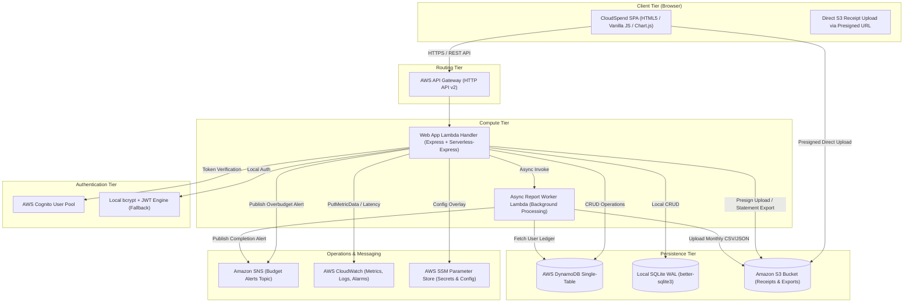

# CloudSpend

> A production-minded personal finance web application built with **Node.js**, **Express**, **SQLite** (`better-sqlite3`), and deep integrations across **8 AWS services** (Cognito, DynamoDB, S3, SNS, CloudWatch, SSM Parameter Store, Lambda, and API Gateway).
> Configured with Indian Rupee (`₹` INR) currency throughout.

Designed with a warm off-white, charcoal, and muted forest-green visual language, CloudSpend delivers an intuitive experience for budgeting, expense and income ledger tracking, financial analytics, interactive multi-date calendar heatmaps, receipt management, and automated overspending alerts.

---

## Table of Contents

1. [Architecture Overview](#architecture-overview)
2. [The 8 AWS Cloud Services & Why They Are Needed](#the-8-aws-cloud-services--why-they-are-needed)
3. [Prerequisites](#prerequisites)
4. [Quickstart (Local Development Mode)](#quickstart-local-development-mode)
5. [Connecting to AWS Cloud Services (Step-by-Step Guide)](#connecting-to-aws-cloud-services-step-by-step-guide)
   * [Deployment Model A: Hybrid Cloud (Local Node App + Live AWS Services)](#deployment-model-a-hybrid-cloud-local-node-app--live-aws-services)
   * [Deployment Model B: Full Serverless Deployment (AWS SAM / API Gateway / Lambda)](#deployment-model-b-full-serverless-deployment-aws-sam--api-gateway--lambda)
   * [Automated 1-Command AWS Setup](#method-1-automated-1-command-aws-setup-fastest)
   * [Manual Step-by-Step AWS Setup](#method-2-manual-step-by-step-aws-setup)
   * [Ready-to-Use IAM Policy Document](#ready-to-use-iam-policy-document)
   * [Testing & Verifying Live AWS Connections](#testing--verifying-live-aws-connections)
6. [Running Automated Tests](#running-automated-tests)
7. [Core Features & Walkthrough](#core-features--walkthrough)
8. [Complete AWS Resource Cleanup (Tear Down)](#complete-aws-resource-cleanup-tear-down)
9. [Troubleshooting & FAQ](#troubleshooting--faq)

---

## Architecture Overview

CloudSpend features a **dual-mode architecture**:
1. **Local Development Mode**: Zero cloud dependencies. Uses an in-process SQLite database with Write-Ahead Logging (`WAL`), local JWT sessions with bcrypt, local receipt uploads, and simulated background tasks.
2. **Production Cloud Mode**: Uses AWS services for identity, persistence, object storage, serverless compute, configuration overlays, operational metrics, and email alerting.



---

## The 8 AWS Cloud Services & Why They Are Needed

| Service | AWS SDK v3 Client Package | Role in CloudSpend | Why It Is Needed |
| :--- | :--- | :--- | :--- |
| **1. Cognito** | `@aws-sdk/client-cognito-identity-provider` | User Authentication & Directory | Secure user identity management, password policies, email verification, and OAuth2/JWT access tokens without building and managing auth infrastructure. |
| **2. API Gateway** | `@vendia/serverless-express` | Serverless HTTP Ingress | Low-latency HTTP API v2 reverse proxy that terminates TLS, applies CORS policies, and invokes the Express application inside Lambda with zero server maintenance. |
| **3. Lambda** | `@aws-sdk/client-lambda` | Compute & Asynchronous Workers | Executes both the primary web application handler and background worker jobs (e.g., generating monthly CSV/JSON reports and computing metrics asynchronously without blocking HTTP requests). |
| **4. DynamoDB** | `@aws-sdk/client-dynamodb`<br>`@aws-sdk/lib-dynamodb` | Cloud Persistence | Fully managed NoSQL database operating on a single-table design (`PK`, `SK`, `GSI1`) that scales to zero when idle and handles high concurrency with single-digit millisecond latency. |
| **5. S3** | `@aws-sdk/client-s3`<br>`@aws-sdk/s3-request-presigner` | Receipts & Statement Storage | Direct browser uploads using 15-minute presigned PUT URLs, preventing large receipt images from bottlenecking web servers. Also stores monthly financial statement exports. |
| **6. SNS** | `@aws-sdk/client-sns` | Real-Time Budget Alerts | Broadcasts instant push notifications to user email addresses whenever a category spending threshold reaches 80% (warning) or 100%+ (overbudget breach). |
| **7. CloudWatch** | `@aws-sdk/client-cloudwatch`<br>`@aws-sdk/client-cloudwatch-logs` | Metrics, Alarms & Logs | Emits custom operational and financial metrics (`TransactionCount`, `TransactionAmount`, `BudgetThresholdExceeded`, `ApiLatency`) and alarms on high 5xx error rates. |
| **8. SSM Parameter Store** | `@aws-sdk/client-ssm` | Dynamic Configuration & Secrets | Fetches sensitive credentials and environment overrides (e.g. `/cloudspend/production/jwt_secret`) on startup, preventing plaintext secrets in code or repository commits. |

> [!NOTE]
> **Data Architecture Note:** CloudSpend explicitly isolates data models between environments. Local development uses SQLite; Cloud mode uses DynamoDB. There is no implicit automatic synchronization between local SQLite and cloud DynamoDB, preventing accidental data pollution or phantom mutations.

---

## Prerequisites

Before starting, ensure you have the following installed on your machine:
- **Node.js**: `v20.x`, `v22.x`, or `v24.x` (Tested and verified on Node `v24.18.1`).
- **npm**: `v10.x` or `v11.x` (Tested on `11.16.0`).
- **Operating System**: Windows 10/11 (PowerShell), macOS, or Linux.
- **AWS Account** *(Required only for cloud mode)*: An active AWS account with permissions to create IAM, DynamoDB, S3, SNS, CloudWatch, and SSM resources.
- **AWS SAM CLI** *(Optional, required only for Model B full serverless deployment)*: `sam --version`.

---

## Quickstart (Local Development Mode)

Run CloudSpend locally with **zero AWS credentials or cloud setup required**.

### Step 1: Open Terminal & Navigate to Directory
```bash
git clone https://github.com/<your-username>/CloudSpend.git
cd CloudSpend
```

### Step 2: Install Dependencies
```bash
npm install
```

### Step 3: Configure Environment Variables
Copy `.env.example` to `.env` (the defaults are pre-configured for local mode):
```bash
cp .env.example .env
```

### Step 4: Seed Sample Data *(Optional but Recommended)*
To populate the database with a pre-configured demo account (`demo@cloudspend.local` / `Password123!`), 17 historical transactions in Indian Rupees (`₹`), and monthly category budgets:
```bash
npm run seed
```

### Step 5: Start the Application
```bash
npm start
```
The server will start on port `3000`:
```
=======================================================
  CloudSpend Server running on port 3000
  URL:          http://localhost:3000
  Environment:  development
  Storage Mode: sqlite
  Auth Provider: local
=======================================================
```

Open your browser to:
👉 **[http://localhost:3000](http://localhost:3000)**

- Click **Sign In** &rarr; **Load Seed Demo Account** to explore immediately, OR
- Click **Create Account** to experience the empty-state workflow with your own isolated user account.

---

## Connecting to AWS Cloud Services (Step-by-Step Guide)

CloudSpend supports two cloud connection models:

- **Deployment Model A: Hybrid Cloud (Local Node App + Live AWS Services)**
  The Express web app runs locally on your PC (`http://localhost:3000`), but connects directly to **live AWS cloud services** (DynamoDB for data, S3 for receipts, SNS for emails, CloudWatch for metrics, and SSM for config). **No serverless deployment or SAM required!**
- **Deployment Model B: Full Serverless Deployment (AWS SAM / API Gateway / Lambda)**
  The entire application is packaged into AWS Lambda functions behind an AWS API Gateway HTTP endpoint.

---

### Method 1: Automated 1-Command AWS Setup (Fastest)

If you already have your AWS Access Keys, you can provision and connect 6+ AWS services with a single script:

#### Step 1: Put your AWS credentials into `.env`:
Open `.env` and set your credentials:
```env
AWS_REGION=us-east-1
AWS_ACCESS_KEY_ID=YOUR_AWS_ACCESS_KEY_ID
AWS_SECRET_ACCESS_KEY=YOUR_AWS_SECRET_ACCESS_KEY
```

#### Step 2: Run the automated resource provisioner:
```bash
npm run aws:setup
```
This automated script will:
1. Authenticate with **AWS STS** and display your Account ID and ARN.
2. Provision the **AWS DynamoDB** single-table (`CloudSpend-Main`) with on-demand billing.
3. Provision the **Amazon S3** bucket (`cloudspend-assets-<accountId>-<region>`) and configure CORS for browser uploads.
4. Create the **Amazon SNS** topic (`CloudSpend-BudgetAlerts`) for push alerts.
5. Create the **Amazon CloudWatch** log group (`/cloudspend/application`) and configure metric collection.
6. Write configuration items to **AWS SSM Parameter Store** (`/cloudspend/config/*`).
7. Automatically write the new resource names and ARNs into your `.env` file.

#### Step 3: Verify the Live AWS Connection:
```bash
npm run test:aws
```
Or open the Web App &rarr; Navigate to **AWS & Cloud Status** &rarr; Click **"⚡ Test AWS Connections Now"**.

---

### Method 2: Manual Step-by-Step AWS Setup

If you prefer to configure each service manually in the AWS Management Console:

#### 1. AWS IAM User & Credentials
1. Open the [AWS IAM Console](https://console.aws.amazon.com/iam/).
2. Click **Users** &rarr; **Create User** &rarr; Name: `cloudspend-user`.
3. In permissions, attach the custom policy defined in [Ready-to-Use IAM Policy Document](#ready-to-use-iam-policy-document).
4. Select user &rarr; **Security credentials** &rarr; **Create access key** &rarr; Choose **Application running outside AWS**.
5. Copy the **Access Key ID** and **Secret Access Key** into `.env`:
   ```env
   AWS_REGION=us-east-1
   AWS_ACCESS_KEY_ID=your_access_key
   AWS_SECRET_ACCESS_KEY=your_secret_key
   ```

#### 2. Service 1: AWS DynamoDB (Cloud NoSQL Database)
1. Open the [AWS DynamoDB Console](https://console.aws.amazon.com/dynamodb/).
2. Click **Create table**:
   * **Table name**: `CloudSpend-Main`
   * **Partition key (`PK`)**: `String`
   * **Sort key (`SK`)**: `String`
3. Under **Table settings**, select **Customize settings**:
   * **Table class**: DynamoDB Standard
   * **Capacity mode**: On-demand (`PAY_PER_REQUEST`)
4. Scroll to **Global secondary indexes** &rarr; Click **Create index**:
   * **Partition key (`GSI1PK`)**: `String`
   * **Sort key (`GSI1SK`)**: `String`
   * **Index name**: `GSI1`
   * **Attribute projections**: All
5. Click **Create table**.
6. In your `.env` file, activate DynamoDB mode:
   ```env
   STORAGE_MODE=dynamodb
   DYNAMODB_TABLE_NAME=CloudSpend-Main
   ```

#### 3. Service 2: AWS S3 (Receipt Uploads & Exports)
1. Open the [AWS S3 Console](https://console.aws.amazon.com/s3/).
2. Click **Create bucket**:
   * **Bucket name**: e.g., `cloudspend-receipts-2026-yourname` (must be globally unique).
   * **AWS Region**: Same as your `AWS_REGION` (e.g. `us-east-1`).
   * **Block Public Access**: Keep all 4 boxes **Checked** (CloudSpend uses presigned URLs; objects never need public access).
3. Open your new bucket &rarr; Click **Permissions** tab &rarr; Scroll down to **Cross-origin resource sharing (CORS)** &rarr; Click **Edit**:
   ```json
   [
     {
       "AllowedHeaders": ["*"],
       "AllowedMethods": ["GET", "PUT", "POST", "HEAD"],
       "AllowedOrigins": ["*"],
       "MaxAgeSeconds": 3600
     }
   ]
   ```
4. In your `.env` file, set:
   ```env
   S3_BUCKET_NAME=cloudspend-receipts-2026-yourname
   ```

#### 4. Service 3: Amazon SNS (Overspending Email Alerts)
1. Open the [AWS SNS Console](https://console.aws.amazon.com/sns/).
2. Click **Topics** &rarr; **Create topic**:
   * **Type**: Standard
   * **Name**: `CloudSpend-BudgetAlerts`
   * **Display name**: `CloudSpend Alerts`
3. Click **Create topic**.
4. Copy the generated **Topic ARN** (e.g. `arn:aws:sns:us-east-1:123456789012:CloudSpend-BudgetAlerts`).
5. In your `.env` file, set:
   ```env
   SNS_TOPIC_ARN=arn:aws:sns:us-east-1:123456789012:CloudSpend-BudgetAlerts
   ```
6. **To receive alerts on your email**: In the CloudSpend Web App, go to the **Wallet & Budgets** tab, enter your email under **AWS SNS Real-Time Budget Alerts**, and click **Subscribe**. Check your email inbox and click **"Confirm subscription"**.

#### 5. Service 4: Amazon CloudWatch (Metrics & Custom Logging)
1. In your `.env` file, enable metrics:
   ```env
   CLOUDWATCH_METRICS_ENABLED=true
   CLOUDWATCH_NAMESPACE=CloudSpend/App
   CLOUDWATCH_LOG_GROUP=/cloudspend/application
   ```
2. When transactions are added or API requests are made, CloudSpend automatically calls `PutMetricData` to publish:
   * `TransactionCount` (Count by Type and Category)
   * `TransactionAmount` (Rupees)
   * `BudgetThresholdExceeded` (Count by Category)
   * `ApiLatency` (Milliseconds by Route and Status)
3. View the live charts in the [AWS CloudWatch Console](https://console.aws.amazon.com/cloudwatch/) under **Metrics** &rarr; **All metrics** &rarr; **CloudSpend/App**.

#### 6. Service 5: AWS SSM Parameter Store (Dynamic Configuration)
1. Open the [AWS Systems Manager Console](https://console.aws.amazon.com/systems-manager/).
2. In the left menu, select **Parameter Store** &rarr; Click **Create parameter**:
   * **Name**: `/cloudspend/config/jwt_secret`
   * **Tier**: Standard
   * **Type**: `SecureString`
   * **Value**: Enter a secure random 32+ character string.
3. In your `.env` file, enable SSM overlay:
   ```env
   SSM_CONFIG_ENABLED=true
   SSM_PARAM_PREFIX=/cloudspend/config/
   ```
4. When CloudSpend starts, it automatically fetches parameters from SSM at runtime.

#### 7. Service 6: Amazon Cognito (User Pool Authentication)
1. Open the [AWS Cognito Console](https://console.aws.amazon.com/cognito/).
2. Click **Create user pool**:
   * **Sign-in options**: Select **Email**.
   * **Password policy**: Defaults (min length 8).
   * **User pool name**: `CloudSpend-UserPool`.
   * **App client type**: Select **Single-page application (SPA)** / **Public client** &rarr; App client name: `CloudSpend-WebClient` &rarr; Client secret: **Don't generate a client secret**.
3. Click **Create user pool**.
4. Open the created App Client (`CloudSpend-WebClient`), go to **Edit app client information** / **Authentication flows**, and ensure **`ALLOW_USER_PASSWORD_AUTH`** (Sign in with username and password) is enabled.
5. Copy the **User pool ID** (e.g. `us-east-1_abcdef123`) and **App client ID**.
6. In your `.env` file, switch auth provider to Cognito:
   ```env
   AUTH_PROVIDER=cognito
   COGNITO_USER_POOL_ID=us-east-1_abcdef123
   COGNITO_CLIENT_ID=1234567890abcdefghijklmnop
   ```

#### 8. Service 7: AWS Lambda (Background Report Worker)
1. The background worker is located at `src/workers/asyncReportWorker.js`.
2. To deploy the worker standalone:
   * Open the [AWS Lambda Console](https://console.aws.amazon.com/lambda/) &rarr; **Create function**:
   * **Function name**: `CloudSpend-ReportWorker`
   * **Runtime**: Node.js 20.x or 22.x
   * **Handler**: `src/workers/asyncReportWorker.handler`
3. In your `.env` file, set:
   ```env
   ASYNC_REPORT_LAMBDA_NAME=CloudSpend-ReportWorker
   ```
4. Test it by clicking **"Trigger Asynchronous Lambda Worker"** under the **AWS & Cloud Status** tab in the web UI.

#### 9. Service 8: Amazon API Gateway (Serverless HTTP Deployment)
See [Deployment Model B](#deployment-model-b-full-serverless-deployment-aws-sam--api-gateway--lambda) below for deploying the Express app serverlessly behind API Gateway.

---

### Deployment Model B: Full Serverless Deployment (AWS SAM / API Gateway / Lambda)

If you want the entire app to run serverless in the cloud (no local Node process):

#### Step 1: Ensure AWS SAM CLI is installed
```bash
sam --version
```

#### Step 2: Build the SAM artifact
```bash
sam build
```

#### Step 3: Deploy to AWS
```bash
sam deploy --guided
```
SAM will ask you:
- **Stack Name**: `cloudspend-prod`
- **AWS Region**: `us-east-1`
- **Confirm changes before deploy**: `y`
- **Allow SAM CLI IAM role creation**: `y`
- **Save arguments to configuration file**: `y`

#### Step 4: Access Your Live Cloud App
SAM outputs your live HTTPS endpoint:
```text
Outputs:
ApiEndpoint = https://abcdef1234.execute-api.us-east-1.amazonaws.com
```
Open this URL in your browser to access the serverless deployment.

---

### Ready-to-Use IAM Policy Document

When creating your IAM User or Role for CloudSpend, attach the following least-privilege policy:

```json
{
  "Version": "2012-10-17",
  "Statement": [
    {
      "Sid": "DynamoDBAccess",
      "Effect": "Allow",
      "Action": [
        "dynamodb:CreateTable",
        "dynamodb:DescribeTable",
        "dynamodb:GetItem",
        "dynamodb:PutItem",
        "dynamodb:UpdateItem",
        "dynamodb:DeleteItem",
        "dynamodb:Query",
        "dynamodb:Scan"
      ],
      "Resource": [
        "arn:aws:dynamodb:*:*:table/CloudSpend-Main",
        "arn:aws:dynamodb:*:*:table/CloudSpend-Main/index/*"
      ]
    },
    {
      "Sid": "S3ReceiptsAccess",
      "Effect": "Allow",
      "Action": [
        "s3:CreateBucket",
        "s3:HeadBucket",
        "s3:PutBucketCors",
        "s3:GetObject",
        "s3:PutObject",
        "s3:DeleteObject"
      ],
      "Resource": [
        "arn:aws:s3:::cloudspend-assets-*",
        "arn:aws:s3:::cloudspend-assets-*/*",
        "arn:aws:s3:::cloudspend-receipts-*",
        "arn:aws:s3:::cloudspend-receipts-*/*"
      ]
    },
    {
      "Sid": "SNSTopicAccess",
      "Effect": "Allow",
      "Action": [
        "sns:CreateTopic",
        "sns:GetTopicAttributes",
        "sns:Publish",
        "sns:Subscribe"
      ],
      "Resource": "arn:aws:sns:*:*:CloudSpend-BudgetAlerts"
    },
    {
      "Sid": "CloudWatchMetricsAndLogs",
      "Effect": "Allow",
      "Action": [
        "cloudwatch:PutMetricData",
        "cloudwatch:ListMetrics",
        "logs:CreateLogGroup",
        "logs:CreateLogStream",
        "logs:PutLogEvents",
        "logs:DescribeLogGroups"
      ],
      "Resource": "*"
    },
    {
      "Sid": "SSMParameterAccess",
      "Effect": "Allow",
      "Action": [
        "ssm:GetParametersByPath",
        "ssm:GetParameter",
        "ssm:PutParameter"
      ],
      "Resource": "arn:aws:ssm:*:*:parameter/cloudspend/*"
    },
    {
      "Sid": "CognitoAccess",
      "Effect": "Allow",
      "Action": [
        "cognito-idp:DescribeUserPool",
        "cognito-idp:SignUp",
        "cognito-idp:InitiateAuth",
        "cognito-idp:GetUser"
      ],
      "Resource": "arn:aws:cognito-idp:*:*:userpool/*"
    },
    {
      "Sid": "LambdaWorkerAccess",
      "Effect": "Allow",
      "Action": [
        "lambda:InvokeFunction",
        "lambda:GetFunction"
      ],
      "Resource": "arn:aws:lambda:*:*:function:CloudSpend-ReportWorker"
    },
    {
      "Sid": "STSIdentity",
      "Effect": "Allow",
      "Action": "sts:GetCallerIdentity",
      "Resource": "*"
    }
  ]
}
```

---

### Testing & Verifying Live AWS Connections

You can verify that your cloud setup is functioning at any time:

#### 1. CLI Diagnostic Command
```bash
npm run test:aws
```
Sample diagnostic output:
```text
================================================================
   CloudSpend — Live AWS Cloud Connectivity Diagnostics
   Region: us-east-1 | Environment: development
================================================================

  AWS Authentication (STS):
  [OK] Authenticated successfully in 142ms
       Account ID : 123456789012
       IAM ARN    : arn:aws:iam::123456789012:user/cloudspend-dev

  1. AWS Cognito (User Pools):
     Status  : [CONNECTED] (180ms)
     Details : Connected to Cognito User Pool "CloudSpend-UserPool"

  2. AWS DynamoDB (Single-Table):
     Status  : [CONNECTED] (95ms)
     Details : Connected to DynamoDB table "CloudSpend-Main" (Status: ACTIVE)

  3. AWS S3 (Receipts & Exports):
     Status  : [CONNECTED] (110ms)
     Details : Connected to S3 bucket "cloudspend-assets-123456789012-us-east-1"

  4. AWS SNS (Budget Alerts):
     Status  : [CONNECTED] (88ms)
     Details : Connected to SNS topic "CloudSpend-BudgetAlerts"

  5. AWS CloudWatch (Metrics & Alarms):
     Status  : [CONNECTED] (92ms)
     Details : Connected to CloudWatch Metrics (Namespace: CloudSpend/App)

  6. AWS SSM (Parameter Store):
     Status  : [CONNECTED] (75ms)
     Details : Connected to SSM Parameter Store (2 parameters at /cloudspend/config/)

  7. AWS Lambda (Async Report Worker):
     Status  : [CONNECTED] (82ms)
     Details : Connected to Lambda worker "CloudSpend-ReportWorker"

================================================================
  Summary: 7 of 7 AWS services connected.
  Status : [EXCELLENT] Production Cloud integration is active!
================================================================
```

#### 2. In-App Web Diagnostics
1. Start the app: `npm start`.
2. Open **[http://localhost:3000](http://localhost:3000)**.
3. Click the **AWS & Cloud Status** tab.
4. Click the blue button **`⚡ Test AWS Connections Now`**.
5. The live ping results, account ID, and latency for every service will render on screen.

---

## Running Automated Tests

CloudSpend includes 22 automated unit and integration tests covering password hashing, JWT security, per-user data isolation, financial calculations in Indian Rupees, budget constraint math, transaction CRUD, pagination, filtering, multi-date querying, and critical API routes.

Run the test suite using Node's native test runner:
```bash
npm test
```

### Test Suite Results
```
▶ Authentication & User Isolation Tests
  ✔ should hash passwords securely and verify them accurately
  ✔ should sign and verify valid JWT tokens
  ✔ should reject tampered or invalid JWT tokens
  ✔ should strictly isolate data between distinct users
✔ Authentication & User Isolation Tests

▶ Financial Ledger & Budget Calculations Tests
  ✔ should accurately calculate monthly summary, net savings, and savings rate
  ✔ should evaluate budget thresholds: normal, warning (>=80%), and overspent (>=100%)
  ✔ should ensure income increases balance without increasing spending, and budget remaining is capped by available cash
✔ Financial Ledger & Budget Calculations Tests

▶ API Route Integration Tests
  ✔ GET /health returns healthy system status
  ✔ GET /api/system/status reports cloud service integration details
  ✔ GET /api/system/test-aws executes live cloud diagnostics suite
  ✔ POST /api/auth/register successfully registers a user
  ✔ GET /api/transactions fails with 401 when unauthenticated
  ✔ GET /api/auth/me returns current user profile with valid token
  ✔ POST /api/budgets configures a category budget
  ✔ POST /api/transactions creates a valid transaction
  ✔ GET /api/transactions retrieves user transactions with pagination
  ✔ POST /api/transactions/by-dates queries transactions for multi-date selection
  ✔ GET /api/budgets/status computes budget tracking and remaining balance
  ✔ DELETE /api/transactions/:id deletes the transaction
✔ API Route Integration Tests

▶ Transaction Repository & Filtering Tests
  ✔ should create, retrieve, update and delete a transaction
  ✔ should filter transactions by type, category, and date range
  ✔ should support multi-date lookup for calendar/heatmap selection
✔ Transaction Repository & Filtering Tests

ℹ tests 22 | suites 4 | pass 22 | fail 0
```

---

## Core Features & Walkthrough

### 1. Dashboard
- **Monthly Spending & Income**: Live calculation of total outflows and inflows for the selected month in Indian Rupees (`₹`).
- **Available Balance**: Cumulative all-time ledger cashflow.
- **Savings Rate & Budget Remaining**: Real-time percentage of income retained and cash-backed remaining budget.
- **Cash-Constrained Budgeting**: Remaining budget never exceeds actual available cash on hand.
- **Dual Action Buttons**: Separate `- Record Expense` and `+ Record Income` buttons with smart keyword detection.
- **Recent Activity**: Quick review of newest transactions with immediate links to details.

### 2. Transactions Ledger
- **Full CRUD**: Create, read, update, and delete transactions with full validation.
- **Search & Filter**: Real-time description search, type filter (expense/income), category filter, payment method filter (Credit Card, Debit Card, Bank Transfer, Digital Wallet, Cash).
- **Receipt Attachment**: Attach receipt images/PDFs. In AWS mode, the client uploads directly to S3 via presigned URLs; in local mode, saves securely to `public/uploads/`.
- **Pagination & Sorting**: Paginated data display with customizable limits.

### 3. Financial Analytics (Chart.js)
- **Spending Trends**: 6-month comparative bar chart comparing monthly income against monthly expenses in ₹.
- **Category Breakdown**: Doughnut chart visualizing exact percentage and rupee distribution per category.
- **Quarterly Performance**: Financial ledger performance broken down across Q1, Q2, Q3, and Q4.
- **Top Spending Categories**: Ranked progress bars highlighting top cash outlays.

### 4. Interactive Monthly Calendar & Heatmap
- **Heatmap Density**: Day cells dynamically shaded (`heat-0` to `heat-4`) based on daily expenditure relative to peak spending.
- **Multi-Date Selection**: Click individual or multiple days to view combined spending, combined income, and net cashflow across the selected dates in Rupee (`₹`).
- **Detailed Date Table**: Selected dates render an aggregated ledger view of all underlying transactions.

### 5. Wallet & Category Budgets
- **Default Monthly Income**: Set baseline expected income for monthly ledger balance forecasting.
- **Threshold Progress**: Category limits monitor spending progress:
  * **Normal**: `< 80%` (Forest Green)
  * **Warning**: `>= 80%` and `< 100%` (Amber / Ochre)
  * **Overspent**: `>= 100%` (Muted Terracotta / Red)
- **Amazon SNS Subscription**: Input your email address to receive immediate push alerts whenever a budget threshold is exceeded.

### 6. Cloud & AWS Status Monitor
- Real-time dashboard view inspecting live status, configuration, and connectivity across all 8 integrated AWS services.
- **⚡ Test AWS Connections Now**: Real-time SDK ping to all 8 AWS services reporting latency and credentials.
- **Trigger Async Lambda Worker**: Dispatches background job generating statements without blocking HTTP clients.
- **Export Statement**: Generates CSV or JSON statement exports and uploads them to Amazon S3 with 24-hour signed download links.

---

## Complete AWS Resource Cleanup (Tear Down)

To cleanly delete all provisioned AWS resources and eliminate recurring charges:

### Step 1: Empty the S3 Bucket
*(S3 prevents deletion of non-empty buckets)*
```bash
AWS_BUCKET_NAME=$(aws cloudformation describe-stacks --stack-name cloudspend-prod --query "Stacks[0].Outputs[?OutputKey=='S3BucketName'].OutputValue" --output text)
aws s3 rm s3://$AWS_BUCKET_NAME --recursive
```

### Step 2: Delete CloudFormation Stack (if using Model B)
```bash
sam delete --stack-name cloudspend-prod --no-prompts
```

### Step 3: Remove DynamoDB Table & SNS Topic (if using Model A)
```bash
aws dynamodb delete-table --table-name CloudSpend-Main
aws s3 rb s3://$AWS_BUCKET_NAME --force
aws ssm delete-parameters --names "/cloudspend/config/jwt_secret" "/cloudspend/config/app_name"
```

---

## Troubleshooting & FAQ

#### 1. "CredentialsProviderError: Could not load credentials from any providers"
- **Solution**: Your AWS credentials are not yet configured. Provide `AWS_ACCESS_KEY_ID` and `AWS_SECRET_ACCESS_KEY` in `.env`, or run `aws configure` in your terminal.

#### 2. S3 Presigned URL Upload Fails with CORS Error
- **Solution**: In AWS Cloud mode, verify that the S3 bucket's CORS configuration allows `PUT` and headers `['*']`. Running `npm run aws:setup` configures this automatically.

#### 3. Email Alerts Not Arriving from Amazon SNS
- **Solution**: Amazon SNS sends a confirmation link to the subscribed email address (`"AWS Notification - Subscription Confirmation"`). You must click the confirmation link in your inbox before SNS will dispatch alerts to that address.

#### 4. Cognito "User is not confirmed" or "USER_PASSWORD_AUTH flow not enabled" Error
- **Solution**:
  - In the AWS Cognito Console under your User Pool, go to **App clients** &rarr; select your SPA client &rarr; enable **`ALLOW_USER_PASSWORD_AUTH`**.
  - Under **Users**, click on the newly registered email address and select **Confirm account**.

#### 5. `better-sqlite3` Native Addon Error
- **Solution**: CloudSpend uses `better-sqlite3` prebuilt binaries. Ensure you are running an LTS Node version (`20.x`, `22.x`, `24.x`).

---
